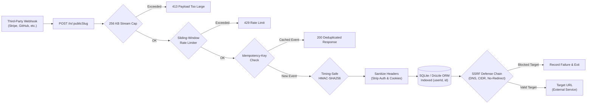

# HookVault 🛡️

> **Security-first, multi-tenant webhook relay, payload inspector, and 1-click replay debugger.**  
> Built under a non-linear red-team engineering constitution with 115 automated adversarial security tests.

[](https://www.typescriptlang.org/)
[](https://hono.dev/)
[](https://orm.drizzle.team/)
[](https://better-auth.com/)
[](https://vitest.dev/)
[](https://www.docker.com/)

---

## What is HookVault?

HookVault solves a universal developer pain point: receiving, inspecting, securing, and debugging third-party webhooks (Stripe, GitHub, Shopify, Slack) in development, staging, and production environments.

Most webhook relays are either insecure toy scripts or black-box SaaS services. HookVault is an open-source, self-hostable webhook vault engineered from ground zero under a **strict security constitution (`AGENTS.md`)**:
- **Zero-Trust Multi-Tenancy:** Hard IDOR defense on all database queries. Tenants can never enumerate or manipulate another tenant's endpoints or event streams.
- **SSRF Defense-in-Depth:** Complete outbound protection against AWS/GCP cloud metadata scraping, localhost probing, private CIDR access, and DNS rebinding attacks.
- **Timing-Safe Cryptography:** Constant-time HMAC-SHA256 signature verification preventing byte-by-byte side-channel discovery.
- **Strict Ingestion Stream Caps:** Pre-buffering 256 KB hard stream cutoff and sliding-window rate limiting to neutralize payload-based DoS.
- **Sanitized Headers & Zero Information Leakage:** Automatic stripping of `Cookie`, `Authorization`, and `Set-Cookie` headers; structured error outputs with zero exposed stack traces or SQL logs.

---

## Inbound & Outbound Pipeline Architecture



---

## Security Architecture & OWASP API Top 10 Defense Matrix

Every security control in HookVault is verified by automated adversarial tests in `tests/security/`:

| OWASP API Top 10 Threat | Attack Vector Mitigated | Primary Defense Implementation | Proving Vitest Suite |
|---|---|---|---|
| **API1:2023 Broken Object-Level Authorization (BOLA / IDOR)** | Cross-tenant access to endpoints, payload events, or replay commands via ID enumeration | Composite indexes `(userId, id)` on all domain tables; mandatory `and(eq(table.id, id), eq(table.userId, session.user.id))` on every query; returns 404 on cross-tenant requests | `tests/security/idor.test.ts`<br>*(13 tests)* |
| **API7:2023 Server-Side Request Forgery (SSRF)** | Pointing webhook target URLs to AWS metadata (`169.254.169.254`), `localhost`, internal subnets (`10.0.0.0/8`, `192.168.0.0/16`), or DNS rebinding | `safeFetch()`: DNS resolution, IPv4/IPv6 private CIDR blocker, `redirect: 'manual'`, 5000ms hard timeout, 64 KB response cap | `tests/security/ssrf.test.ts`<br>*(37 tests)* |
| **API2:2023 Broken Authentication (Timing Attacks)** | Measuring string comparison response times to guess valid HMAC-SHA256 signatures byte-by-byte | `crypto.timingSafeEqual` on equal-length Buffers; length check before comparison; random 32-byte secret generation | `tests/security/hmac.test.ts`<br>*(24 tests)* |
| **API2:2023 Broken Authentication (Replay Attacks)** | Replaying intercepted webhook payloads at a later time | Timestamp embedded in signed content (`{timestamp}.{body}`); strict $\pm 5$ min tolerance window; `Idempotency-Key` deduplication | `tests/security/replay.test.ts`<br>*(4 tests)* |
| **API3 & API6:2023 Mass Assignment & Broken Object Property** | Injecting `userId`, `role`, `plan`, `createdAt`, or `encryptedSecret` into request payloads | Every Zod schema enforces `.strict()`; all responses pass through explicit output DTO serializers | `tests/security/massAssignment.test.ts`<br>*(12 tests)* |
| **API4:2023 Unrestricted Resource Consumption (DoS)** | Sending 100 MB payloads or flooding ingestion endpoints | Inbound 256 KB body stream cutoff before JSON parsing; per-endpoint sliding-window rate limiting | `tests/security/payload.test.ts`<br>*(4 tests)*<br>`tests/security/rateLimit.test.ts`<br>*(11 tests)* |
| **API8:2023 Security Misconfiguration (Error Leakage)** | Leaking database errors, file paths, or stack traces in HTTP responses | Global structured error handler; returns `{ error: { code, message } }` with zero stack traces or SQL strings | `tests/security/headersAndErrors.test.ts`<br>*(10 tests)* |
| **API8:2023 Security Misconfiguration (Headers)** | Clickjacking, MIME sniffing, and cross-site scripting | Global Hono `secureHeaders()`: `CSP`, `X-Content-Type-Options: nosniff`, `X-Frame-Options: DENY`, `Referrer-Policy: no-referrer` | `tests/security/headersAndErrors.test.ts` |

---

## Tech Stack

- **Runtime & Web Framework:** TypeScript (ES2022, strict mode), [Hono](https://hono.dev/)
- **Database & ORM:** [Drizzle ORM](https://orm.drizzle.team/) + SQLite ([`better-sqlite3`](https://github.com/WiseLibs/better-sqlite3) with WAL mode, 100% Cloudflare D1-compatible schema)
- **Validation & Serialization:** [Zod](https://zod.dev/) with `.strict()` schemas and output DTOs
- **Authentication:** [Better Auth](https://better-auth.com/) (`^1.7.27`) with secure session cookies
- **Testing Engine:** [Vitest](https://vitest.dev/) (115 red-team security tests)
- **Frontend Inspector:** React 19 + Vite + Tailwind CSS + Lucide Icons (consuming typed API contracts)
- **Containerization:** Multi-stage Dockerfile (glibc bookworm-slim base) serving static UI & API from a single binary/port

---

## Quickstart

### Prerequisites
- Node.js >= 20.x or 22.x
- npm >= 10.x

### 1. Clone & Install
```bash
git clone https://github.com/your-username/hookvault.git
cd hookvault

# Install backend dependencies
npm install

# Install frontend dependencies
npm --prefix web install
```

### 2. Configure Environment
Create a `.env` file in the project root:
```env
PORT=3001
NODE_ENV=development
ENCRYPTION_KEY=0123456789abcdef0123456789abcdef0123456789abcdef0123456789abcdef
BETTER_AUTH_SECRET=hookvault-development-secret-change-me-in-production-min-32-chars
BETTER_AUTH_URL=http://localhost:3001
FRONTEND_ORIGIN=http://localhost:5173
ALLOW_LOCAL_TARGETS=false
RATE_LIMIT_WINDOW_MS=60000
RATE_LIMIT_MAX_REQUESTS=100
```

### 3. Run the Security Test Suite (115 Tests)
```bash
npm test
```
*All 115 tests will execute and pass in approximately 6 seconds.*

### 4. Run the Development Servers
In two separate terminals:

```bash
# Terminal 1: Backend API (runs on port 3001)
npm run dev:api

# Terminal 2: Frontend UI (runs on port 5173)
npm --prefix web run dev
```

Open `http://localhost:5173` in your browser. Register an account, create a webhook endpoint, and copy your public ingestion URL!

---

## Testing Webhook Ingestion & Replay

### 1. Send a Test Inbound Webhook
```bash
curl -X POST http://localhost:3001/in/<YOUR_PUBLIC_SLUG> \
  -H "Content-Type: application/json" \
  -H "X-Custom-Header: value" \
  -d '{"event":"payment_intent.succeeded","amount":4200}'
```

### 2. Send an HMAC-Signed Webhook
Generate a signature with your endpoint secret and timestamp:
```bash
TIMESTAMP=$(date +%s)
PAYLOAD='{"event":"order.created","id":"ord_123"}'
SIGNATURE=$(echo -n "${TIMESTAMP}.${PAYLOAD}" | openssl dgst -sha256 -hmac "<YOUR_ENDPOINT_SECRET>" | awk '{print $2}')

curl -X POST http://localhost:3001/in/<YOUR_PUBLIC_SLUG> \
  -H "Content-Type: application/json" \
  -H "X-Webhook-Timestamp: ${TIMESTAMP}" \
  -H "X-Webhook-Signature: ${SIGNATURE}" \
  -d "${PAYLOAD}"
```

In the UI inspector, you will see the delivery attempt, duration, response snippet, and a **`VALID`** HMAC badge.

---

## Production Deployment

### Single-Service Production Build
HookVault builds into a single self-contained Node.js service serving both the React UI and Hono API:

```bash
# Build both backend and frontend
npm run build

# Run in production mode on port 3000
NODE_ENV=production PORT=3000 node dist/server.js
```

### Docker Deployment
The multi-stage `Dockerfile` handles build isolation and non-root execution:

```bash
# Build Docker image
docker build -t hookvault .

# Run container with persistent data volume
docker run -d \
  -p 3000:3000 \
  -v hookvault_data:/app/data \
  -e ENCRYPTION_KEY="<64-hex-char-secret>" \
  -e BETTER_AUTH_SECRET="<random-32-char-secret>" \
  --name hookvault hookvault
```

Ready for one-click deployment to **Fly.io**, **Railway**, or **Render** using the provided `Dockerfile`.

---

## Repository Structure

```
hookvault/
├── Dockerfile                   # Multi-stage production container
├── AGENTS.md                    # Security engineering constitution & non-negotiables
├── THREAT_MODEL.md              # OWASP API Top 10 threat analysis
├── SECURITY_AUDIT.md            # Comprehensive security audit & invariant proof
├── src/
│   ├── app.ts                   # Hono app with security headers, CORS & error handlers
│   ├── server.ts                # Production & local HTTP server with SQLite WAL
│   ├── auth/                    # Better Auth configuration
│   ├── contracts/               # Zod .strict() input schemas & output DTOs
│   ├── db/                      # Drizzle schema, indexes & initialization
│   ├── middleware/              # Authentication guards & zero-leakage error handling
│   ├── routes/                  # Tenant endpoints, events & public /in/:slug ingest
│   └── security/                # SSRF safeFetch, timingSafeEqual HMAC, rateLimiter
├── tests/
│   ├── helpers/                 # Test database & multi-tenant seed fixtures
│   └── security/                # 115 adversarial red-team tests
└── web/                         # React 19 + Tailwind CSS payload inspector UI
```

---

## License

MIT
